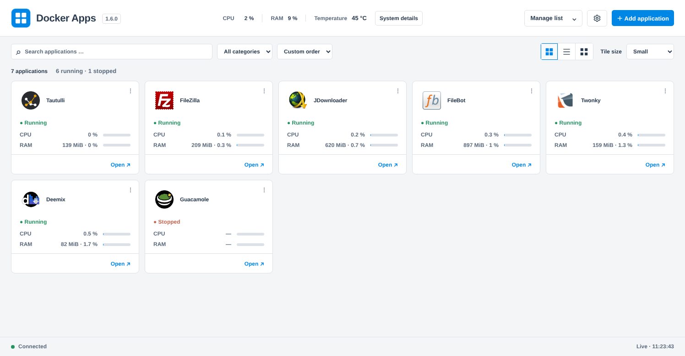

# Docker_APPS-Launcher

DSM 7.2+ launcher for container web interfaces, with a shared application list on the NAS and read-only live monitoring.

## Why I built this

I built this app because I could no longer add direct links to my Docker container web interfaces in Synology DSM's Container Manager. Docker_APPS-Launcher gives me a central place to collect and open those links.

## Download 1.6.3

[Download SPK 1.6.3](https://github.com/nemesis122/Docker_APPS-Launcher/releases/download/v1.6.3/docker-apps-monitor_noarch-1.6.3-0.spk) · [Release notes](https://github.com/nemesis122/Docker_APPS-Launcher/releases/tag/v1.6.3) · [Application source](https://github.com/nemesis122/Docker_APPS-Launcher/archive/refs/tags/v1.6.3.zip) · [SHA256 checksums](https://github.com/nemesis122/Docker_APPS-Launcher/releases/download/v1.6.3/SHA256SUMS-1.6.3.txt)

SPK SHA256:

```text
cc3a944b209cd532ba253847c275fea29d7226dbe0789c1e0e780bd2e06e0eec
```

## New in 1.6.3

- Live states distinguish connecting, active, paused, off and permission/session failures, with DSM guidance.
- Empty lists offer container import, manual app creation and the current storage location.
- Live starts enabled on first launch and preserves a saved disabled preference.
- Startup regression coverage and enforced LF endings for installation scripts.

## Since 1.6.1

- The source code is licensed under **GPL-3.0-or-later**. The licence text is included in the package and linked in the app. No functional changes compared with 1.6.0.

## New in 1.6.0

- **Own categories** in addition to the five built-in ones.
- **Sorting** by name or category, and an **own order** by drag and drop or position number.
- **NAS-address links:** with "Always use the current NAS address", a link keeps working when DSM is opened through another host name or IP. Only the host name is replaced; port and path stay.
- **Container network and disk rates** in the details window.
- **An existing list is found automatically** when a new browser has no saved storage location.
- Build and text fixes. The bundled icons are unchanged.

## Since 1.5.0

- Redesigned interface: CPU, RAM and temperature in the header, grouped "Manage list" and settings menus, view buttons, running/stopped counter (1.5.6–1.5.8).
- Individual old history entries can be deleted; the current version is protected (1.5.5).
- Dependency-free build script for Windows, macOS and Linux (`build-windows.cjs`).

## Features

Container import, CPU/RAM per container, NAS CPU/RAM/temperature, network rates, volume usage, tile/list/icon views, five tile sizes, light and dark themes, German and English, JSON export/import, version history with restore, selectable storage location and an offline icon library.

## Requirements and installation

Requires **DSM 7.2-64570 or later**, File Station and appropriate folder/application permissions. Live container data additionally requires Container Manager permissions.

1. Download the SPK.
2. In DSM, open Package Center → Manual Install and select the file.
3. Open Docker Apps. The shared list is stored in `docker/Docker APPS` by default; another shared folder can be chosen under Manage list → Storage location.

The app does not start, stop or modify containers and requests no root installation privileges. It writes and deletes only `apps-*.json` files inside the `Docker APPS` folder, using the File Station permissions of the signed-in DSM user.

## Upgrade notice

Upgrading from 1.4.x, 1.5.x or 1.6.0 keeps the existing list. The app keeps the newest 30 list versions and removes older ones.

A 1.5.x installation can still read a list saved by 1.6.x, but shows own categories as "Other" and ignores the NAS-address option. If you run both versions against the same list, saving from 1.5.x drops those two details.

## Test status

60 automated checks and 25 browser scenarios pass against a simulated DSM Web API. Version 1.5.8 runs on a real NAS with real containers; the 1.6.0 additions have not yet been verified on NAS hardware. Details: [VALIDATION.md](VALIDATION.md).

## Screenshots

Browser screenshots of version 1.6.0 with **simulated demonstration data only**. No real NAS or private user data is shown.



[Dark theme](docs/screenshots/docker-apps-1.6.0-dark.png) · [Container rates in the details window](docs/screenshots/docker-apps-1.6.0-container-rates.png)

## Building from source

The repository contains the complete application source.

```sh
node build-windows.cjs   # any platform, no dependencies -> dist/*.spk + SHA256SUMS
./build.sh               # Linux/macOS alternative, same archive layout
```

Tests (after a build):

```sh
node --test tests/*.test.js tests/package.test.cjs
npm install                  # Playwright, only for the browser tests
node tests/ui.e2e.js
node tests/ui-regression.cjs
```

| Path | Content |
| --- | --- |
| `src/app/` | DSM app (Ext.js wrapper, launcher UI in `src/app/ui/`). `__VERSION__` is replaced during the build. |
| `spk/` | SPK metadata: `INFO`, install wizard, scripts, privileges, package icons |
| `tests/` | Simulated DSM (`fake-dsm.js`), unit tests, browser tests |
| `VERSION` | Package version used by both build scripts |

Full history: [CHANGELOG.md](CHANGELOG.md) · Test scope and limits: [VALIDATION.md](VALIDATION.md)

## License

Copyright © 2026 nemesis122.

The application source code is free software: you can redistribute it and/or modify it under the terms of the [GNU General Public License](LICENSE) as published by the Free Software Foundation, either version 3 of the License, or (at your option) any later version (GPL-3.0-or-later). Redistributed versions must stay under the GPL and include their source. The licence text is also included in the package and linked in the app under Settings → About & licenses.

The bundled icons are **not** covered by the GPL. They come from [selfh.st/icons](https://github.com/selfhst/icons) (CC BY 4.0) plus individually attributed logos; names, logos and trademarks belong to their respective owners. Detailed credits: [`src/app/ui/licenses/`](src/app/ui/licenses/).
