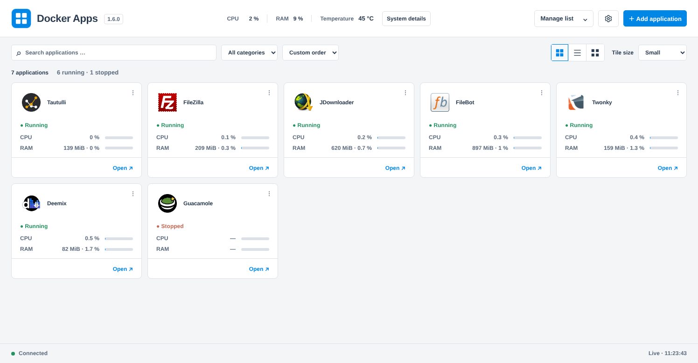

DSM launcher for container web applications, with a shared NAS application list and read-only live monitoring.

## What's new in 1.6.1

- **Licence:** the source code is licensed under **GPL-3.0-or-later** ([LICENSE](https://github.com/nemesis122/Docker_APPS-Launcher/blob/v1.6.1/LICENSE)). The licence text is included in the package and linked in the app under *Settings → About & licenses*. The bundled icons keep their own licences (CC BY 4.0 and brand rights).
- No functional changes compared with 1.6.0.

## Included from 1.6.0

- **Own categories:** besides the five built-in categories, any name can be entered in the editor ("New category …"). Own categories appear in the filter.
- **Sorting and own order:** new selector with *Custom order*, *By name* and *By category*. In the custom order, tiles can be dragged with the mouse or given a position number in the editor.
- **NAS-address links:** new option "Always use the current NAS address". The stored address stays complete; on opening, only the host name is replaced by the address DSM is open with, so links keep working when DSM is reached through another host name or IP. Existing entries are not changed.
- **Container network and disk rates:** download/upload and read/write rates per container in the details window (icon view) and as a tooltip on the metrics in the other views. No additional DSM request.
- **Existing list is found automatically:** a browser without a saved storage location looks for a `Docker APPS` list in the other shared folders when `docker` has none, and uses it if there is exactly one. Read-only.
- **Fixes:** `build.sh` writes the same archive layout as `build-windows.cjs`; neutral DSM search description.
- **Repository:** the complete source, tests and build scripts are now in the Git repository.

The bundled icons are unchanged. The package identity remains `docker-apps`.

## App preview

Browser screenshot of version 1.6.0 (unchanged in 1.6.1) with **simulated demonstration data only**. No real NAS or private user data is shown.



[Dark theme](https://raw.githubusercontent.com/nemesis122/Docker_APPS-Launcher/v1.6.0/docs/screenshots/docker-apps-1.6.0-dark.png) · [Container rates](https://raw.githubusercontent.com/nemesis122/Docker_APPS-Launcher/v1.6.0/docs/screenshots/docker-apps-1.6.0-container-rates.png)

## Requirements and installation

The package declares **DSM 7.2-64570 or later**. File Station and suitable folder/application permissions are required. Container Manager permissions are additionally required for live monitoring and container discovery.

Download `docker-apps-monitor_noarch-1.6.1-0.spk` from the assets and use **DSM Package Center → Manual Install**. Export your application list before upgrading a live system.

## Upgrade notice

The existing list is kept; the list format is unchanged. The newest 30 list revisions are retained, as before.

A 1.5.x installation can still read a list saved by 1.6.x, but shows own categories as "Other" and ignores the NAS-address option. Saving from 1.5.x drops those two details.

## Test status

54 automated checks, 20 functional browser scenarios and the UI regressions passed with simulated DSM responses. Version 1.5.8 runs on a real NAS with real containers; **the 1.6.x additions have not yet been verified on NAS hardware.** If DSM reports container statistics in an unexpected shape, the new rates show dashes and nothing else is affected. See [VALIDATION.md](https://github.com/nemesis122/Docker_APPS-Launcher/blob/v1.6.1/VALIDATION.md).

## Files

- `docker-apps-monitor_noarch-1.6.1-0.spk` — installable package, built by GitHub Actions from the tagged source.
- `SHA256SUMS-1.6.1.txt` — checksum of the package.
- Source: the tagged repository ("Source code" below).

```text
f1878ffa4ce0e4d8118fa68d115a01031c690debc2f7d37deb0e4d811eb16542  docker-apps-monitor_noarch-1.6.1-0.spk
```
